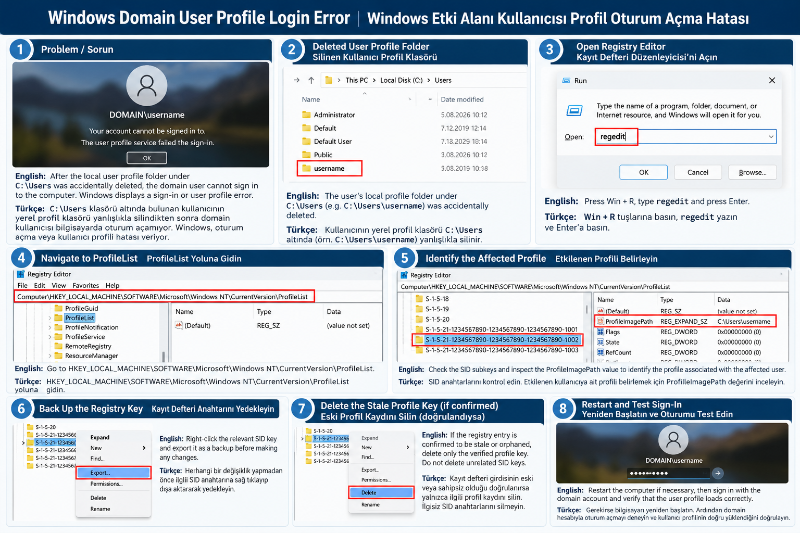

# Windows Domain User Profile Login Error
# Windows Etki Alanı Kullanıcısı Profil Oturum Açma Hatası

## Problem / Sorun

**English:**

A domain user cannot sign in to a Windows computer after their local user profile folder under `C:\Users` was accidentally deleted. Windows displays a sign-in error or a user profile error.

**Türkçe:**

`C:\Users` klasörü altında bulunan kullanıcının yerel profil klasörü yanlışlıkla silindikten sonra domain kullanıcısı Windows bilgisayarda oturum açamıyor. Windows, oturum açma veya kullanıcı profili hatası veriyor.

## Environment / Ortam

- Windows client computer — Windows istemci bilgisayarı
- Active Directory domain account — Active Directory etki alanı hesabı
- Local user profile under `C:\Users` — `C:\Users` altındaki yerel kullanıcı profili

## Possible Cause / Olası Neden

**English:**

Deleting the profile folder does not necessarily remove its registry entry. An outdated or inconsistent profile registration may prevent Windows from loading the user's profile correctly.

**Türkçe:**

Kullanıcı profil klasörünün silinmesi, kayıt defterindeki profil kaydını otomatik olarak silmeyebilir. Eski veya tutarsız bir profil kaydı, Windows'un kullanıcı profilini doğru yüklemesini engelleyebilir.

## Troubleshooting and Resolution / Sorun Giderme ve Çözüm

### 1. Sign in with an administrator account
### 1. Yönetici hesabıyla oturum açın

Use another authorized administrator account on the affected computer.

Etkilenen bilgisayarda yetkili başka bir yönetici hesabıyla oturum açın.

### 2. Open Registry Editor
### 2. Kayıt Defteri Düzenleyicisi'ni açın

Run `regedit` and navigate to:

`HKEY_LOCAL_MACHINE\SOFTWARE\Microsoft\Windows NT\CurrentVersion\ProfileList`

`regedit` komutunu çalıştırın ve yukarıdaki kayıt defteri yoluna gidin.

### 3. Identify the affected profile
### 3. Etkilenen profili belirleyin

Check the SID subkeys under `ProfileList` and inspect the `ProfileImagePath` value to identify the profile associated with the affected user.

`ProfileList` altındaki SID anahtarlarını kontrol edin. Etkilenen kullanıcıya ait profili belirlemek için `ProfileImagePath` değerini inceleyin.

### 4. Back up the registry key
### 4. Kayıt defteri anahtarını yedekleyin

Export the relevant registry key before making any changes.

Herhangi bir değişiklik yapmadan önce ilgili kayıt defteri anahtarını dışa aktararak yedekleyin.

### 5. Correct the stale profile registration if confirmed
### 5. Eski profil kaydını doğrulandıysa düzeltin

If the registry entry is confirmed to be stale or orphaned, follow your organization's procedure to remove or correct only the verified profile entry. Do not delete unrelated SID keys.

Kayıt defteri girdisinin eski veya sahipsiz olduğu doğrulanırsa kurum prosedürünü izleyerek yalnızca doğrulanmış profil kaydını silin veya düzeltin. İlgisiz SID anahtarlarını silmeyin.

### 6. Test domain sign-in
### 6. Domain oturum açmayı test edin

Restart the computer if necessary, then test sign-in with the domain account and verify that the user profile loads correctly.

Gerekirse bilgisayarı yeniden başlatın. Ardından domain hesabıyla oturum açmayı deneyin ve kullanıcı profilinin doğru yüklendiğini doğrulayın.

## Important Notes / Önemli Notlar

- Back up the registry before making changes. — Değişiklik yapmadan önce kayıt defterini yedekleyin.
- Verify the SID and `ProfileImagePath` carefully. — SID ve `ProfileImagePath` değerlerini dikkatlice doğrulayın.
- Registry changes can cause additional problems if the wrong key is modified. — Yanlış anahtarda yapılan kayıt defteri değişiklikleri ek sorunlara neden olabilir.
- This procedure applies only when the profile registration is the cause; other sign-in errors require separate troubleshooting. — Bu yöntem yalnızca sorunun nedeni profil kaydı olduğunda geçerlidir; diğer oturum açma hataları ayrıca incelenmelidir.

## Result / Sonuç

**English:**

After the incorrect profile registration is corrected, the domain user can sign in successfully if no other issue is present.

**Türkçe:**

Hatalı profil kaydı düzeltildikten sonra, başka bir sorun yoksa domain kullanıcısı bilgisayarda yeniden oturum açabilir.
